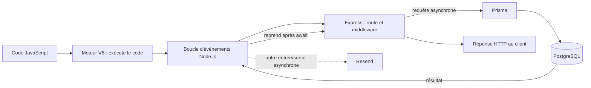
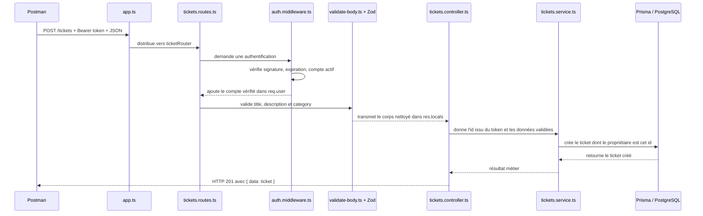

# Comprendre Node.js et ce projet

Ce guide suit une requête réelle du projet pour montrer comment les fichiers travaillent ensemble.

## 1. Node.js, JavaScript, Express et API

- **JavaScript** est le langage écrit dans les fichiers `.js` et `.ts` du projet.
- **Node.js** exécute ce JavaScript en dehors du navigateur, par exemple sur un serveur.
- **Express** est une bibliothèque Node.js qui aide à recevoir des requêtes HTTP et à définir des routes.
- Une **API** est un ensemble de règles et d'adresses permettant à deux programmes d'échanger des données.
- **HTTP** est le protocole de cet échange. Une requête porte une méthode (`GET`, `POST`, `PATCH`), une URL, des en-têtes (headers) et parfois un corps JSON. Le serveur répond avec un statut (`200`, `201`, `400`, `401`, `403`, etc.) et souvent du JSON.

Postman joue ici le rôle du client. Il envoie une requête à Express, puis affiche la réponse.

## 2. Ce que fait Node.js pendant une requête



`async` et `await` rendent le code plus lisible quand Node attend PostgreSQL ou Resend. Pendant cette attente, Node peut avancer sur d'autres requêtes. Un `await` ne crée pas un nouveau thread JavaScript : il suspend la fonction courante jusqu'au résultat.

## 3. Les dossiers du projet

```text
src/
├── server.ts        démarre le serveur et écoute sur le port
├── app.ts           configure Express, les limites, routes et erreurs
├── routes/          associe méthode + URL à des middleware et contrôleurs
├── middlewares/     vérifie l'identité, les rôles et les données
├── controllers/     lit les données validées, appelle le service, répond au client
├── modules/         schémas Zod et types des fonctionnalités
├── services/        règles métier, appels à Prisma et à Resend
├── utils/           fonctions partagées : sécurité, réponses HTTP, rate limit
└── db.ts            instance partagée de Prisma Client

prisma/schema.prisma décrit les modèles de la base.
prisma/migrations/ contient les changements SQL appliqués dans l'ordre.
tests/ contient les tests unitaires et les tests HTTP avec PostgreSQL.
```

## 4. Une requête pas à pas : créer un ticket

Le client envoie :

```http
POST /tickets
Authorization: Bearer <accessToken>
Content-Type: application/json

{
  "title": "Je ne peux pas me connecter",
  "description": "Le site affiche une erreur après le login.",
  "category": "AUTHENTICATION"
}
```

Le client affiche par exemple « Authentification », mais envoie à l'API la valeur technique `AUTHENTICATION`.

Son parcours dans le code :



1. `app.ts` est l'application Express. Elle ajoute un identifiant de requête, limite les appels et analyse le JSON.
2. `tickets.routes.ts` reconnaît la combinaison `POST /tickets` et enchaîne les middlewares dans l'ordre écrit.
3. `requireAuthentication` vérifie le token et met l'utilisateur authentifié dans `req.user`. Le client ne choisit donc pas le propriétaire du ticket dans son JSON.
4. `validateBody(createTicketSchema)` utilise Zod. Si le titre, la description ou la catégorie manque ou ne respecte pas les règles, la requête s'arrête avec une erreur `400`.
5. Le contrôleur appelle le service et indique le code de réponse HTTP `201`, qui signifie « ressource créée ».
6. Le service applique la règle métier et demande à Prisma d'enregistrer le ticket dans PostgreSQL.

## 5. Où les données sont vérifiées

| Vérification | Fichier / couche | Exemple |
|---|---|---|
| JSON, paramètres URL, filtres query | `src/modules/*/*.schemas.ts` avec `validate-body.ts` | titre non vide, catégorie connue, `page` positive, statut dans la liste prévue |
| Token et compte actif | `src/middlewares/auth.middleware.ts` | access token présent, signature et expiration correctes |
| Rôle permis | `requireRoles(...)` dans les routes | seul le support peut changer le statut d'un ticket |
| Règles métier | `src/services/` | un utilisateur ne voit que ses tickets |
| Contraintes des données | `prisma/schema.prisma` et PostgreSQL | e-mail unique, relations et clés étrangères |

Les niveaux se complètent : Zod vérifie la forme des données entrantes; le middleware vérifie qui fait la demande; le service vérifie ce que cette personne a le droit de faire; la base protège la cohérence des données.

## 6. Mots de passe et tokens

- Un **mot de passe** n'est pas stocké directement. `security.ts` calcule une empreinte avec `scrypt`, puis le login compare le mot de passe reçu à cette empreinte.
- L'**access token** est une preuve d'identité signée à durée courte. Le client l'envoise dan `Authorization: Bearer ...`.
- Le **refresh token** sert à renouveler la session. Sa valeur brute n'est pas stockée dans la base; seul son hash est gardé, ce qui permet de le révoquer.
- Le **rôle** est comparé à la politique de route après authentification. Un token valide prouve l'identité; il n'accorde pas automatiquement tous les droits.

## 7. Prisma et la base

`prisma/schema.prisma` est la description des modèles côté application. Les migrations traduisent les changements du schéma en instructions SQL versionnées. Prisma Client permet ensuite au service d'appeler la base avec du TypeScript :

```ts
const ticket = await prisma.ticket.create({
  data: { title, description, category, createdById: userId },
});
```

Les valeurs sont passées comme paramètres de la requête Prisma. Le projet n'assemble pas de SQL en insérant les textes reçus d'un client, ce qui réduit le risque d'injection SQL.

## 8. Comment présenter le projet au professeur

Tu peux raconter le flux dans cet ordre : « Postman envoie une requête HTTP à Node.js. Express choisit une route. Les middlewares vérifient le token, le rôle et les données avec Zod. Le contrôleur appelle le service. Le service applique la règle métier et utilise Prisma pour lire ou modifier PostgreSQL. Enfin, Express renvoie un code HTTP et une réponse JSON. »

Pour étudier une fonctionnalité, pars de sa route, puis suis les imports vers son contrôleur, son service, son schéma Zod et les modèles Prisma concernés.
